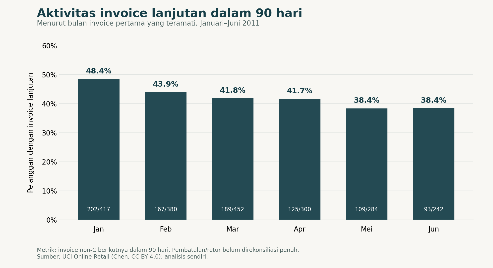
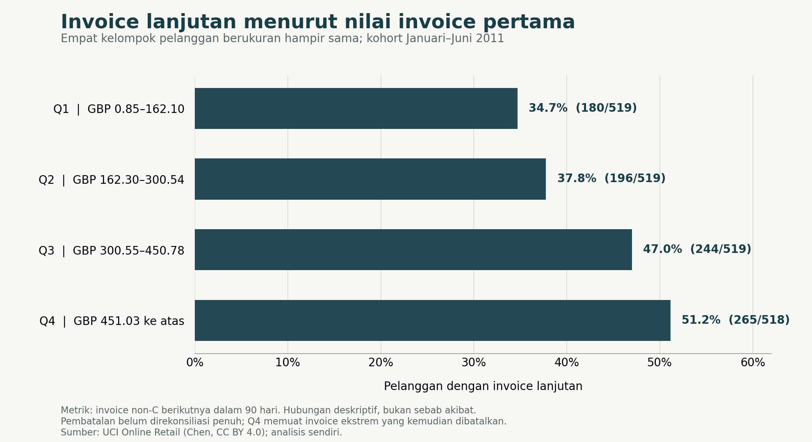

# Aktivitas invoice lanjutan pelanggan toko daring

## Pertanyaan

Di antara pelanggan dengan invoice pertama yang **teramati** pada Januari–Juni 2011, berapa proporsi yang memiliki invoice non-pembatalan berikutnya dalam 90 hari? Bagaimana proporsi itu berbeda menurut bulan dan nilai invoice pertama?

Analisis ini memakai [Online Retail dari UCI Machine Learning Repository](https://archive.ics.uci.edu/dataset/352/online%2Bretail), data transaksi toko daring Inggris yang dikurasi oleh Daqing Chen. Lisensi: CC BY 4.0. Periode data: 1 Desember 2010 sampai 9 Desember 2011.

## Pendekatan

1. Memeriksa 541.909 baris sumber, termasuk `CustomerID` kosong, pembatalan, harga/kuantitas nonpositif, dan baris identik.
2. Membentuk tabel invoice dari baris yang memiliki `CustomerID`, nomor invoice tidak berawalan `C`, `Quantity > 0`, dan `UnitPrice > 0`. Hasilnya 18.532 invoice dari 4.338 pelanggan.
3. Memilih invoice pertama **yang terlihat dalam data** untuk tiap pelanggan dengan `ROW_NUMBER()`; kohort Januari–Juni 2011 berisi 2.075 pelanggan.
4. Menandai pelanggan yang memiliki invoice non-C lain, bernomor berbeda, lebih dari 0 dan paling lama 90 hari setelah invoice pertama. Jendela 90 hari seluruh kohort ini tercakup sebelum akhir data.
5. Membagi nilai invoice pertama menjadi empat kelompok berukuran hampir sama dengan `NTILE(4)`, lalu menguji kepekaan hasil terhadap penghapusan baris identik dan pembatalan.

Query utama tersedia di [query kohort](03_repeat_purchase.sql), sementara [`DATA_AUDIT.md`](DATA_AUDIT.md) mencatat pemeriksaan dan keputusan analisis.

## Temuan

**885 dari 2.075 pelanggan (42,7%)** memiliki invoice non-C berikutnya dalam 90 hari. Ini adalah ukuran **aktivitas invoice lanjutan**, bukan retensi pembelian bersih.

Proporsi per kohort bulanan berada pada 48,4% untuk Januari dan 38,4% untuk Juni. Perbedaan ini bersifat deskriptif; komposisi pelanggan, produk, dan pembatalan dapat berbeda antarbulan.

Kelompok nilai invoice pertama terendah memiliki proporsi 34,7% (180/519), sedangkan kelompok tertinggi 51,2% (265/518). Selisih **16,5 poin persentase** ini menunjukkan hubungan dalam data, bukan bahwa nilai invoice pertama menyebabkan aktivitas lanjutan.

## Pemeriksaan yang mengubah interpretasi

- **Baris identik:** nilai invoice pertama berubah untuk 197 pelanggan jika baris identik dihapus. Proporsi per kelompok nilai hanya bergeser sedikit, tetapi tidak ada bukti bahwa semua baris identik adalah kesalahan, sehingga baris tersebut dipertahankan.
- **Pembatalan:** invoice pertama terbesar, GBP 77.183,60, dibatalkan penuh 16 menit kemudian. Audit sederhana hanya dapat memasangkan 2.787 dari 8.905 baris pembatalan yang memiliki pelanggan dan harga positif dengan baris sebelumnya; 598 pasangan memiliki lebih dari satu kandidat. Karena itu, pembatalan tidak dihapus otomatis dari transaksi asal.
- **Riwayat terbatas:** data dimulai pada Desember 2010. Invoice pertama yang terlihat pada Januari–Juni 2011 tidak membuktikan bahwa pelanggan benar-benar baru.

## Keputusan yang disarankan

Sebelum memakai angka ini untuk keputusan kampanye atau target retensi, sistem transaksi perlu menyimpan hubungan eksplisit antara pembatalan/retur dan invoice asal. Setelah status transaksi dapat direkonsiliasi, analisis dapat diulang memakai pembelian bersih dan pelanggan baru yang definisinya jelas. Untuk saat ini, grafik berguna sebagai **pemantauan aktivitas invoice**, dengan batasan di atas selalu ditampilkan.

## Alat

SQLite untuk transformasi dan agregasi SQL; Python/pandas untuk impor serta audit; Matplotlib untuk grafik. Semua proses berjalan lokal tanpa layanan berbayar.
